# aPiStation

**Un cloud personal pe Raspberry Pi, cu interfață de consolă pe HDMI.**
Filme, muzică, jocuri, smart home, stocare și recomandări AI (Claude) într-un singur meniu
navigat cu controlerul, totul gamificat: XP, niveluri, trofee, misiuni zilnice și streak-uri.

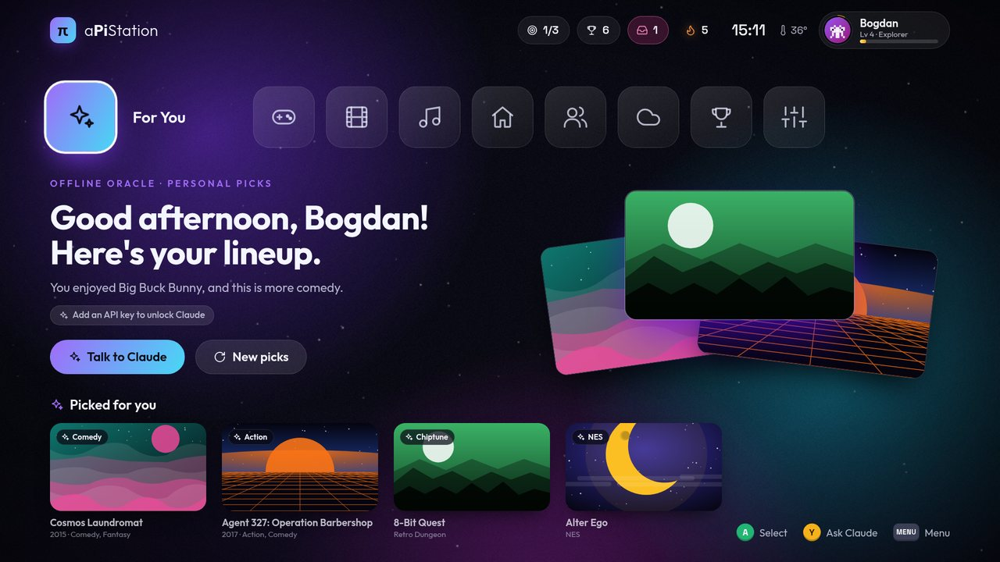

| | |
|---|---|
| 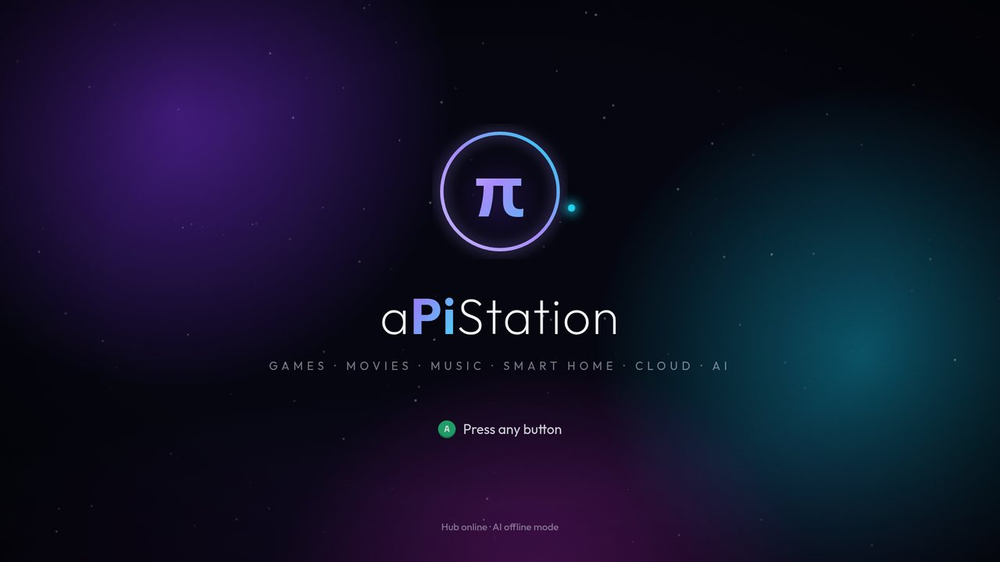 | 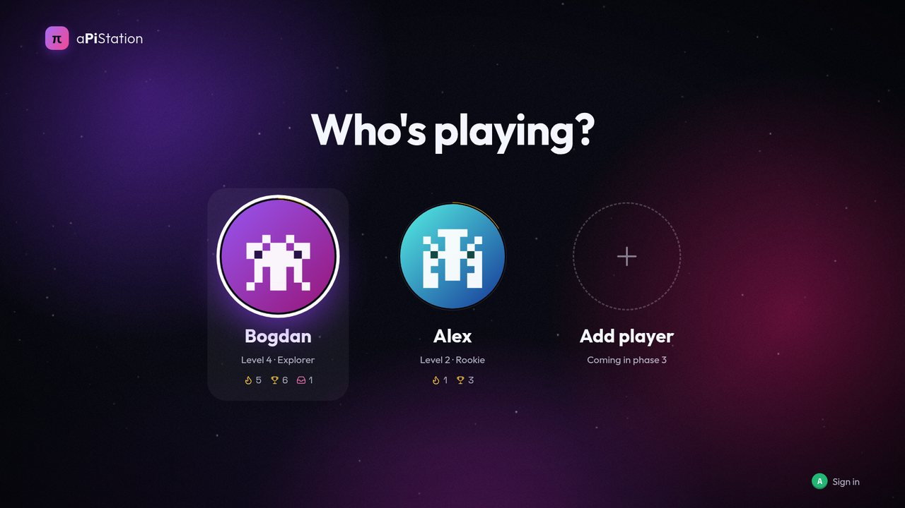 |
| 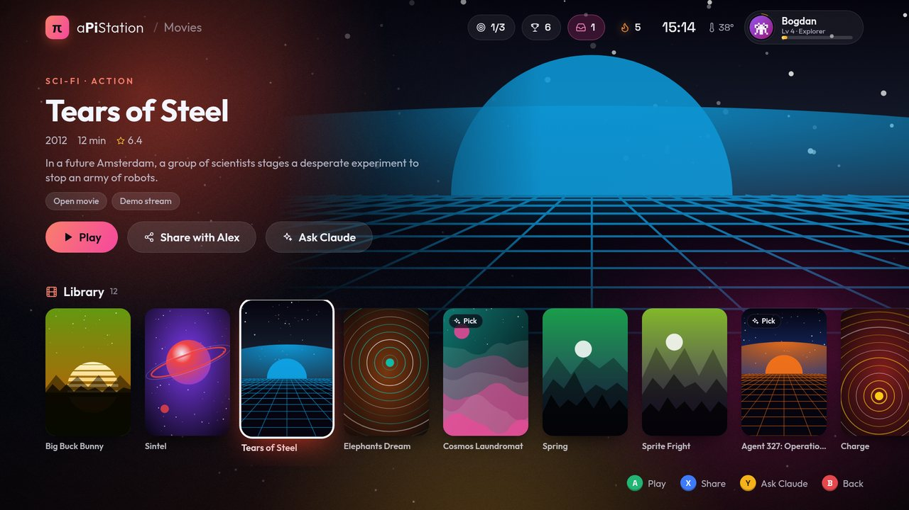 | 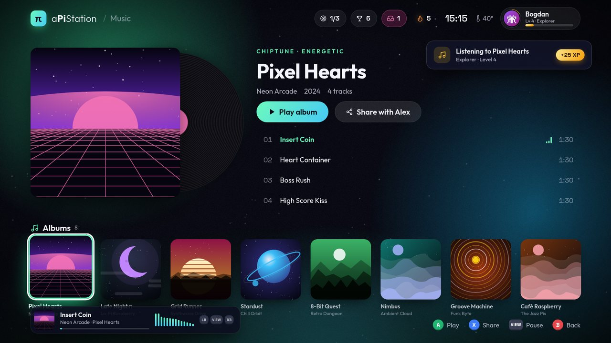 |
| 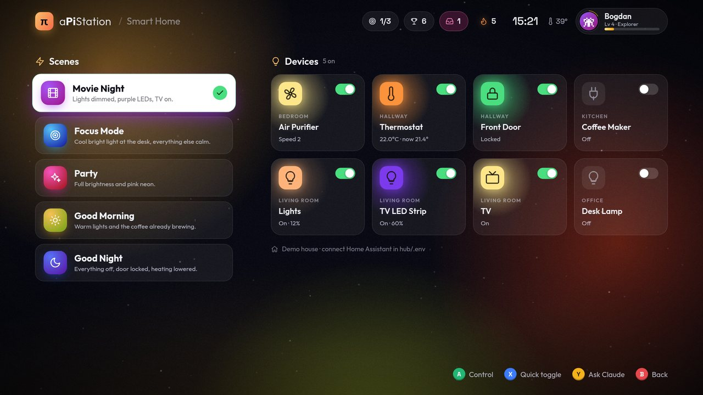 | 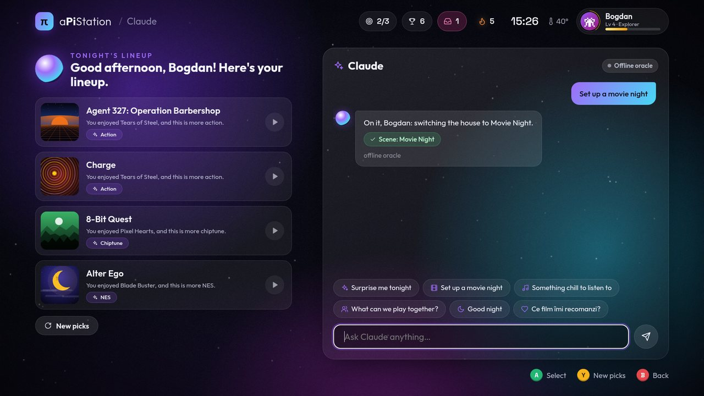 |
| 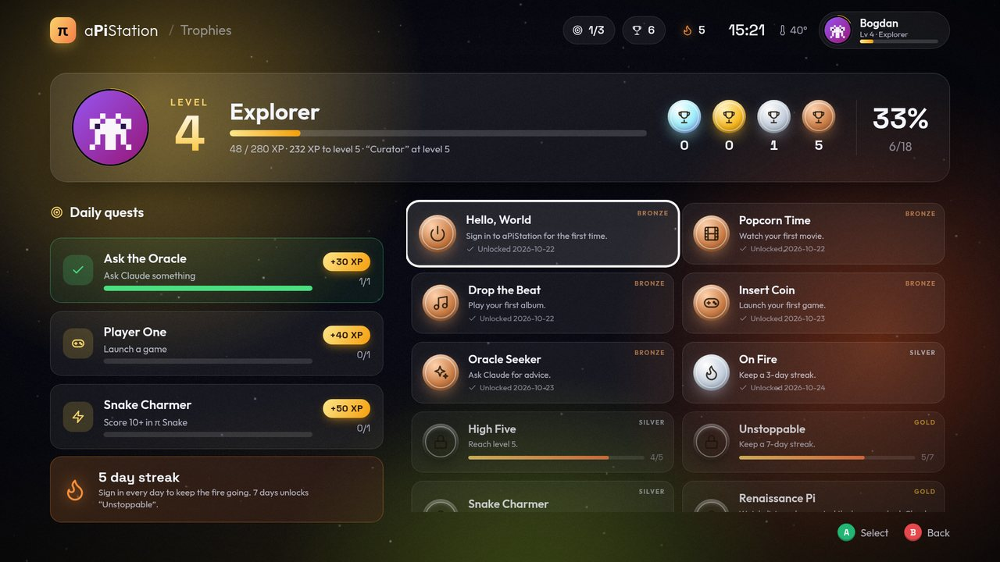 | 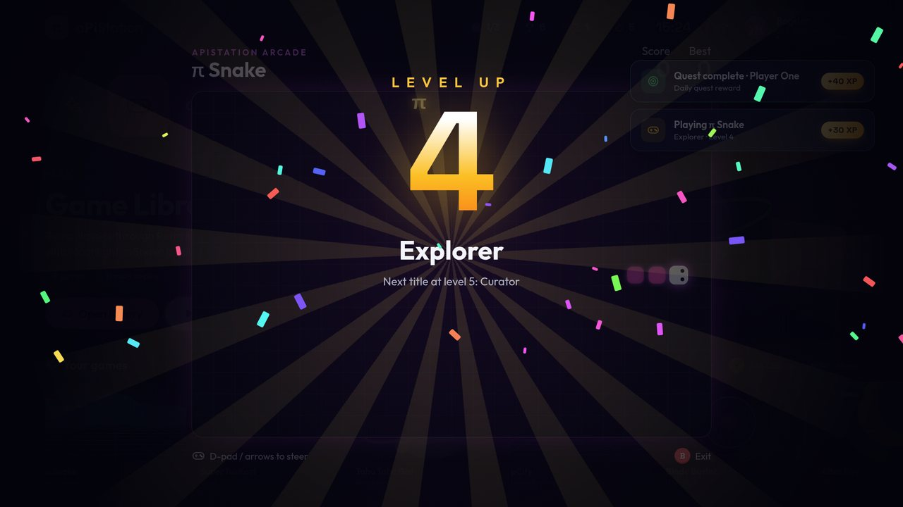 |
| 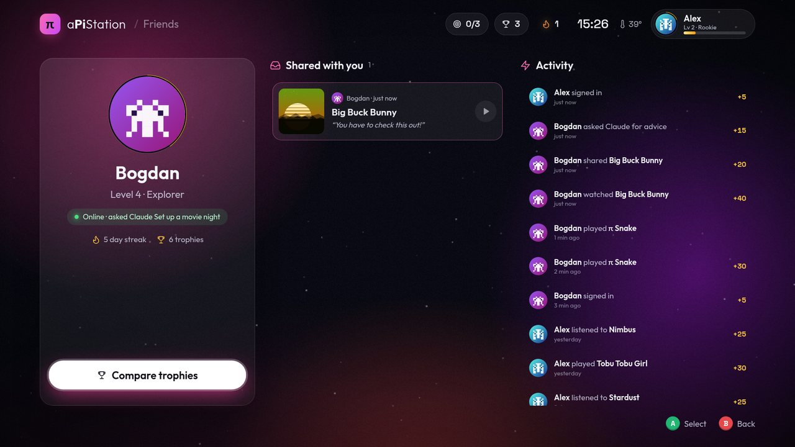 | 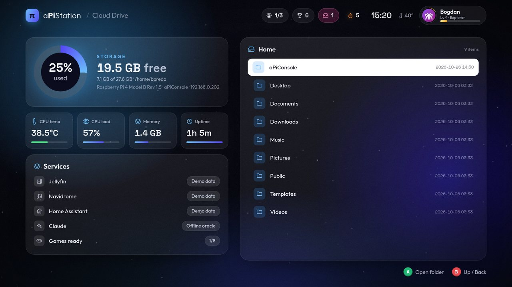 |

Planul complet (arhitectură, etape, demo): [docs/PLAN.md](docs/PLAN.md).

## Pornire rapidă

```bash
scripts/dev.sh
```

Apoi deschide `http://localhost:8420` (sau `http://<ip-pi>:8420` de pe laptop).
Scurtătură pentru dezvoltare: `http://localhost:8420/?profile=bogdan&screen=movies` sare peste boot.

### Boot direct în consolă (kiosk pe HDMI)

```bash
kiosk/install.sh
```

Instalează hub-ul ca serviciu systemd și înlocuiește desktopul labwc cu consola în fullscreen.
După `sudo reboot`, Pi-ul pornește direct în aPiStation. Revenire la desktop: `kiosk/uninstall.sh`.

### Asistentul gratuit (chat) și Claude (recomandări)

**Chat-ul rulează pe Pi, gratuit**: un model mic (Qwen2.5 1.5B, licență Apache 2.0) prin serverul llama.cpp.
Nu consumă tokeni, merge offline și conversațiile rămân pe Pi. Se instalează o singură dată, fără sudo:

```
scripts/install-local-llm.sh
```

(descarcă modelul de ~1.1 GB, compilează llama.cpp în ~20 de minute și pornește serviciul `apistation-llm`).
Răspunde în limba în care îi scrii, cu câteva cuvinte pe secundă, afișate pe măsură ce le scrie.
Comenzile merg instant, fără model: „play Sintel”, „play Daft Punk” / „pune-mi Queen” (orice artist sau piesă),
„movie night lights”, „good night”.

**Claude face doar recomandările** (lineup-ul din For You, filmele și Claude's mix), cam o dată pe zi per profil,
cu cache. Pune cheia în `hub/.env` (copiat din [hub/.env.example](hub/.env.example)):

```
ANTHROPIC_API_KEY=sk-ant-...
```

Fără cheie, recomandările vin din istoric, topuri și filme cu rating mare, ca demo-ul să meargă oricând.

## Movies (în stil Netflix)

- **Recomandări Claude din toate filmele lansate vreodată**, nu doar din ce e pe Pi, pe baza filmelor văzute și notate
  (👍/👎) și a listei tale: „Top picks for you” și „Because you watched…”, fiecare cu motivul alegerii.
- **Căutare** în orice film (catalogul public Cinemeta, bazat pe IMDb): poster, fundal, rating, regizor, distribuție, trailer.
- **My List** și biblioteca **Watched**, care rămâne și după ce ștergi fișierul filmului.
- **Descărcări doar legale**: filmele Blender (Creative Commons) și clasice în domeniul public și în România/UE
  (Nosferatu, Faust, Sunrise, Potemkin, Caligari...), de pe Internet Archive. Lista e verificată manual în
  [hub/app/films_catalog.py](hub/app/films_catalog.py); eticheta de licență de pe Internet Archive nu e luată de bună
  (am găsit filme comerciale urcate cu licență CC falsă).
- Filmele descărcate rulează pe TV cu VLC sau, de pe laptop, direct în browser (streaming de pe Pi).
- Nu există integrare cu trackere de torrente (FileList etc.): filmele de acolo sunt protejate de drepturi de autor.

## Music (în stil YouTube Music)

- **Caută orice piesă sau artist** în catalogul public Deezer (fără cont), cu coperți, topuri și pagini de artist.
- **Claude's mix**: un playlist de 15 piese din toată muzica, pe baza a ce asculți, dai 👍 sau 👎.
- **Radio fără sfârșit**: când coada se termină, hub-ul adaugă piese asemănătoare (radio-ul artistului + artiști înrudiți);
  piesele cu 👎 nu mai apar. Istoric „Recently played” și „Liked songs”.
- **Piese întregi prin playerul oficial YouTube** (legal, embed), cu cheie gratuită `YOUTUBE_API_KEY` în `hub/.env`
  (Google Cloud → YouTube Data API v3 → API key). Fără cheie se aud preview-uri de 30 s de la Deezer.
- Pe Music screen video-ul stă în panoul din dreapta; pe alte ecrane, în colț (picture-in-picture) cât timp cântă.
- Atenție: YouTube blochează majoritatea pieselor de la case de discuri pe pagini deschise prin IP. De pe laptop
  folosește `http://apiconsole.local:8420`, nu `http://192.168.x.x:8420`. TV-ul (kiosk, `localhost`) merge.

## For You

Recomandări pe toate categoriile, pe un singur ecran: **Tonight's lineup** (din ce e pe Pi), **Films for you**
(din toate filmele), **Claude's mix**, **Games for you** (din biblioteca ta și din Store, cu jocuri de 2 jucători
când se potrivește), **For the house** (scena potrivită momentului) și **New in your Cloud Drive**. Fiecare are
motivul alegerii. Claude face lista o dată pe zi (cache); fără cheie, totul vine din istoric și topuri.
În dreapta e asistentul gratuit.

## Cloud Drive (NAS)

- Folder propriu: `~/aPiCloud` (sau `APISTATION_STORAGE`), cu **Shared** pentru toți și câte un folder
  **personal** pentru fiecare profil. Restul Pi-ului (inclusiv `hub/.env` cu cheile) nu e accesibil prin Drive.
- **Upload** din orice browser (buton sau drag & drop), cu progres, plus **preview** pentru poze, video, muzică,
  text și PDF; **download**, **folder nou**, **rename**, **mutare** între Shared și folderul tău.
- **Coș de gunoi**: ștergerea mută în `.trash`, păstrat 30 de zile.
- **Link de share** pentru orice fișier, valabil 7 zile (`/s/<token>`), fără cont.
- Upload-urile dau XP și trofeul **Cloud Keeper** (10 fișiere).
- **Acces din afara casei:** cu [Tailscale](https://tailscale.com) (gratuit), o rețea privată între Pi și
  dispozitivele tale, fără porturi deschise în router: `scripts/setup-tailscale.sh` (vezi mai jos).
  Instalezi aplicația și pe telefon/laptop, cu același cont. Drive-ul afișează adresa de oriunde.

## Profiluri, PIN și modul Guest (demo online în siguranță)

- **Profilurile reale au PIN** (4 cifre, salvat ca hash scrypt). La prima intrare consola cere crearea lui,
  iar **primul PIN se poate crea doar din rețeaua de acasă**. Se schimbă din Settings → Change PIN.
- **„Remember this device”** ține sesiunea 90 de zile (TV-ul cere PIN-ul o singură dată); altfel 12 ore.
  Sesiunea stă într-un cookie HttpOnly. Sign out din meniul rapid sau din Settings.
- **5 PIN-uri greșite** blochează 10 minute; **10 pe oră** blochează profilul de oriunde.
- **Guest** (fără PIN) e doar pentru vizitat:
  - poate să se uite peste tot, să joace în browser (EmulatorJS, π Snake), să asculte muzică, să vadă
    trailere și filmele libere și să vorbească cu asistentul local;
  - **nu poate** să șteargă sau să instaleze ceva, să urce fișiere, să pornească ceva pe TV, să controleze
    casa, să trimită share-uri, nici să vadă datele lui Bogdan sau Alex;
  - **nu folosește niciodată Claude** (deci nu costă bani) și are un folder demo separat în Cloud Drive.
- **Limite**: cereri pe minut per sesiune, mesaje la asistent (Guest: 4/minut, 40/zi) și maximum 8 recomandări
  Claude forțate pe oră pentru jucători.
- Fiecare cerere e verificată pe hub: profilul din cerere trebuie să fie cel logat.

**Acces de oriunde și link public de demo, cu Tailscale** (gratuit, fără porturi deschise în router):

```
scripts/setup-tailscale.sh
```

Scriptul instalează Tailscale din depozitul oficial (cere parola sudo o dată), conectează Pi-ul la contul tău
(link de login în browser) și pornește **Funnel**. Rezultatul:

- **Acces privat**: de pe telefonul sau laptopul tău, cu aplicația Tailscale logată în același cont, consola
  e la `http://apiconsole:8420`, de oriunde. Pe cineva anume (de exemplu profesorul) îl inviți din
  contul Tailscale și ajunge doar la acest Pi.
- **Link public fix**: `https://apiconsole.<tailnet>.ts.net`, același și după repornire. Vizitatorii pot intra
  doar ca **Guest** (read-only); Bogdan și Alex cer PIN-ul, iar un prim PIN nu se poate crea prin link.
  Apare și în Cloud Drive → Access from anywhere.
- Oprești link-ul public (accesul privat rămâne) cu `tailscale funnel --https=443 off` și îl repornești cu
  `tailscale funnel --bg 8420`.

## Game Store

Tile-ul **Store** din meniu are 33 de jocuri gratuite și legale, cu poze oficiale, pe care le descarci și le ștergi
când vrei (progres live, XP, misiunea „New Arrival” și trofeul „Game Collector”):

- **Retro** (19): homebrew original de pe [Homebrew Hub](https://hh.gbdev.io) și din release-urile autorilor:
  Tobu Tobu Girl, Varooom 3D, Deadeus, Shock Lobster, Cave Story (Mega Drive), Kart Racer, GBAtris...
- **PC** (14): jocuri open-source din Debian: Luanti (tip Minecraft), SuperTux (tip Mario), SuperTuxKart, OpenTTD,
  Freedoom (Doom), Hedgewars (tip Worms), Neverball, Frozen Bubble, Wesnoth...

Jocurile PC se instalează cu apt, deci au nevoie o singură dată de:

```bash
sudo ~/aPiConsole/kiosk/setup-store.sh
```

Scriptul pune un helper care poate instala sau șterge **doar** pachetele de jocuri din catalog
([hub/app/store_catalog.py](hub/app/store_catalog.py)) și o regulă sudo doar pentru acel helper.
Anulare: `sudo ~/aPiConsole/kiosk/setup-store.sh --remove`.

Jocuri comerciale (Mario, Pokémon, Sonic...) nu se descarcă din magazin. ROM-urile tale, făcute după cartușele pe care
le deții, le copiezi în `~/roms/<platformă>/` (`nes`, `snes`, `gb`, `gbc`, `gba`, `md`, `sms`, `gg`): apar în Games în
cel mult un minut, cu box art original luat automat de la libretro-thumbnails dacă fișierul are numele din setul
No-Intro (ex. `Tetris (World) (Rev 1).gb`), și se pot șterge din Games.

Pe TV rulează cu RetroArch (`scripts/install-emulators.sh` instalează emulatoarele); în joc, **Start + Select**
(ținute apăsat) te întorc în aPiStation.

**Joc în browser (laptop):** când deschizi consola de pe laptop, jocurile retro au butoanele **Play here**
(rulează în browser cu [EmulatorJS](https://emulatorjs.org), încărcat de pe CDN-ul lor, versiunea 4.2.3) și
**Play on TV** (RetroArch pe Pi). Taste: săgeți, Z = A, X = B, Enter = Start, V = Select, Esc = ieșire.
Salvările din browser rămân în browserul respectiv. Pe TV (kiosk) rămâne doar Play, cu RetroArch.

## Controale

| Acțiune | Tastatură | Controler |
|---|---|---|
| Navigare | săgeți | D-pad / stick |
| Selectează | Enter | A |
| Înapoi | Esc / Backspace | B |
| Share cu prietenul | X | X |
| Asistentul (chat) | Y | Y |
| Meniu rapid | M | Start |
| Pauză muzică / piesa anterioară / următoare | V / Q / E | View / LB / RB |

## Ce e real și ce e demo

| Funcție | Acum | Cu configurare |
|---|---|---|
| Interfață, navigare, sunete, gamificare | real | — |
| Profiluri, XP, trofee, misiuni, share între useri | real (SQLite) | — |
| Statistici Pi (temperatură, CPU, RAM, disc) | real | — |
| Cloud Drive (NAS): upload, preview, share links, coș | real, în `~/aPiCloud` | `APISTATION_STORAGE` pe SSD; Tailscale pentru acces din afară |
| Muzică | căutare în tot catalogul Deezer, Claude's mix, radio infinit, preview 30 s; albume demo sintetizate | `YOUTUBE_API_KEY` → piese întregi; Navidrome |
| Filme | bibliotecă demo (Blender open movies), player simulat | fișiere în `~/Videos` → VLC, sau Jellyfin |
| Jocuri | π Snake + Game Store cu 33 de jocuri gratuite (retro și PC) | ROM-urile tale în `~/roms/<platformă>/`, cu box art automat |
| Smart home | casă demo în memorie | Home Assistant |
| Asistent (chat) | comenzi (scene, „play …”) | `scripts/install-local-llm.sh` → model local gratuit |
| Recomandări AI | din istoric și topuri | `ANTHROPIC_API_KEY` → Claude |

## Structură

```
hub/        backend FastAPI: API unificat, gamificare, Claude, adaptere (Jellyfin, Navidrome, HA, RetroArch)
console/    interfața TV: HTML/CSS/JS fără build, servită de hub
kiosk/      serviciu systemd + autostart labwc pentru boot în consolă
scripts/    utilitare de dezvoltare
docs/       plan, capturi de ecran
```
